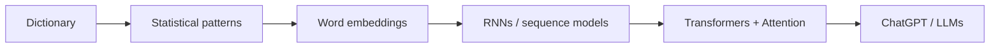
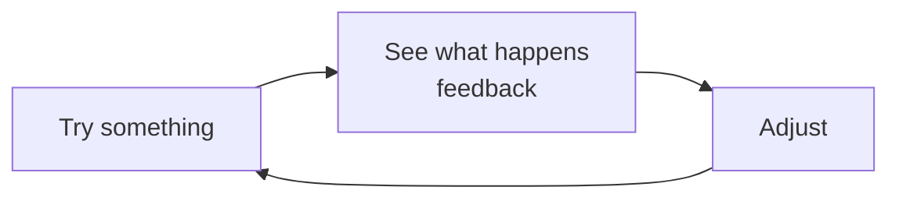
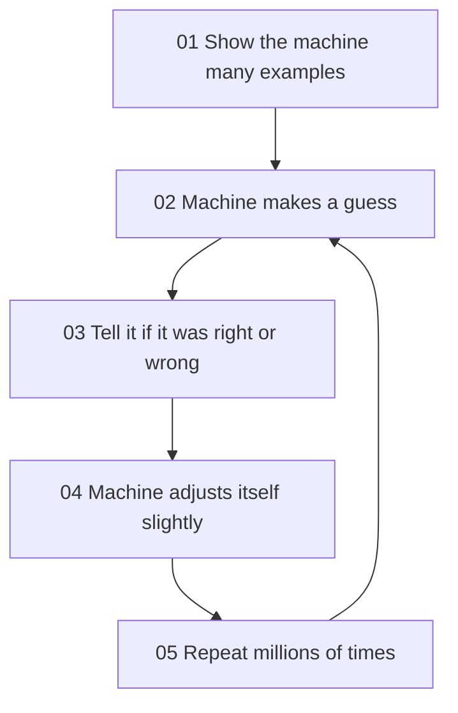
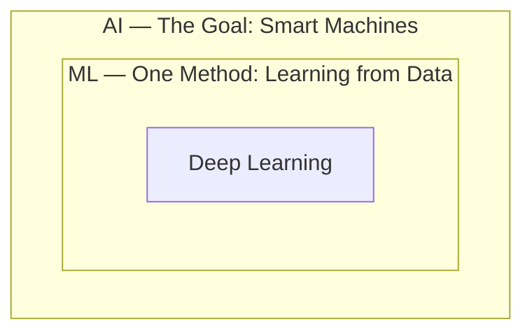
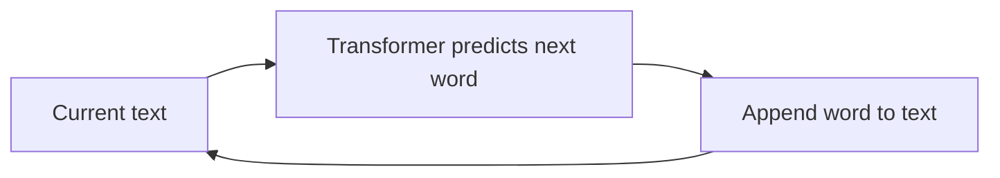
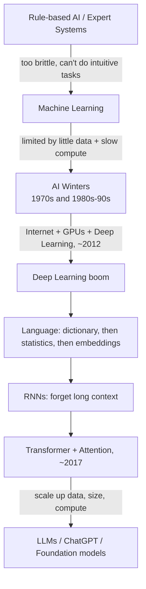

# 📘 Class 01 — Fast-Tracking the Course of AI

> **Bootcamp:** 100xBootcamp by Harkirat Singh  
> **Week 1 — AI and ML** | **Date:** 18/01/2026  
> **Theme:** From *"What is AI?"* to *"How ChatGPT works"*  
> **Class resource:** [LLM Visualization (3D walkthrough)](https://bbycroft.net/llm)

---

## 1. Class Overview

This class is a fast tour of the whole story of AI. It starts with the basic questions (*What is learning? What is knowledge? What is intelligence?*), then follows the history: hand-written rules, machine learning, the "AI winters", and the boom after 2012.

The second half goes deep on **one problem: understanding language**. We watch each attempt fail for a reason, and each failure leads to the next idea:



By the end, you should be able to explain in plain words how ChatGPT works.

## 2. Learning Objectives

After studying these notes you should be able to:

- Explain **learning**, **knowledge** and **intelligence** in simple terms.
- Differentiate **AI**, **Machine Learning** and **Deep Learning**.
- Explain why rule-based AI failed and why ML needed **data + compute + better algorithms**.
- Describe what the **AI winters** were and why AI exploded after **2012**.
- Explain **word embeddings** and why "words as numbers" was a breakthrough.
- Explain why **RNNs forget** and how **attention** fixes this.
- Describe in simple words how **ChatGPT** generates text.
- Explain **emergent capabilities**, **scaling** and **foundation models**.

## 3. Topics Covered

1. What does it mean to learn? / What is knowledge? / What is intelligence?
2. What is AI? (AI = the goal)
3. Attempt #1: Write the rules (Expert Systems) and the problem with rules
4. Attempt #2: Let machines learn (Machine Learning)
5. AI vs ML vs Deep Learning
6. Early ML: successes and bottlenecks (data, compute)
7. AI Winters (1970s, 1980s–90s)
8. Why AI exploded after 2012
9. Language understanding as the case study: why language is hard
10. NLP Attempt #1 (Dictionary) and #2 (Statistical patterns)
11. Breakthrough: words as numbers → Word embeddings
12. Embedding space, "word math", and the limits of basic embeddings
13. NLP Attempt #4: Sequence models (RNNs) and the forgetting problem
14. The Transformer idea and Attention
15. How ChatGPT works (Transformer + Internet data + Prediction)
16. Scaling, emergent capabilities, foundation models
17. Where we are (2024–2025): multimodality, reasoning, agents

---

## 4. Detailed Class Notes

### 4.1 What does it mean to learn?

> **Learning = changing yourself based on experiences. Basically, adjustments.**

Learning is a **loop**:



**Example:** A child touches a hot cup (*try*), feels pain (*feedback*), and next time is careful (*adjust*).

**Key point:** This same loop is exactly how machines "learn" later in this class.

### 4.2 What is knowledge?

The slides pose the questions *"What is knowledge? What does it mean to know?"* and name **two types of knowledge**:

| Type | Meaning (see extra context below) |
|---|---|
| **Explicit knowledge** | Knowledge you can write down or explain in words |
| **Implicit knowledge** | Knowledge you have but cannot easily explain |

> 📌 **Extra Context**  
> The slides only name the two types. The usual meaning is: *explicit* = "I can explain how to add two numbers." *Implicit* = "I can recognize my friend's face or ride a bicycle, but I can't write exact rules for how I do it."  
> This idea matters later: **rule-based AI works for explicit knowledge, but fails for implicit knowledge.**

### 4.3 What is intelligence?

> **Intelligence is the ability to achieve goals in a wide range of situations.**

Notice the phrase *"wide range of situations"*. A calculator achieves a goal, but only in one narrow situation, so it is not considered very intelligent.

### 4.4 What is AI?

The class opens with the question: *"What comes to mind when you hear 'Artificial Intelligence'?"*

> **AI = The Goal:** Making machines do things that would require intelligence if a human did them.

**Examples:** recognizing faces, understanding language, playing chess, driving a car.

**Key point:** AI describes **what we want** (smart machines), not **how** we build them. Different *methods* can be used to reach this goal.

### 4.5 Attempt #1 — Write the Rules (Expert Systems)

The first idea: write explicit **if-then rules** by hand.

| Task | Example rule |
|---|---|
| Spam detection | If the email contains `free money` → spam |
| Medical | If temperature > 100°F → fever |
| Chess | If a piece can move to a square AND the square has an enemy piece → capture |

This is called **Expert Systems** or **Rule-Based AI**.

```python
def is_spam(email: str) -> bool:
    # A tiny rule-based "expert system"
    return "free money" in email.lower()

print(is_spam("Claim your FREE MONEY now!"))   # True
print(is_spam("Meeting at 5 pm"))              # False
```

*Explanation:* We (the human) wrote the rule. The computer only follows it. If a spammer writes "fr33 m0ney", the rule fails, and we must write another rule.

#### The Problem with Rules

Rules fail for tasks humans do **intuitively** (implicit knowledge):

| Task | Why rules fail |
|---|---|
| **Recognizing a face** | How do you define the exact distance between eyes or the curve of a nose for every possible angle and lighting? |
| **Understanding sarcasm** | "Oh, great." Is it good or a complaint? Rules can't easily capture tone and context. |
| **Decoding idioms** | "It's raining cats and dogs." A rule-based system might look for falling animals instead of understanding the metaphor. |

### 4.6 Attempt #2 — Let Machines Learn (Machine Learning)

> Instead of writing rules, **show the machine thousands of examples and let it figure out the patterns.**

This is called **Machine Learning (ML)**.

#### How ML works (intuitively)



**The analogy from class:** *"Like a child learning by trial and error."* This is the same **try → feedback → adjust → repeat** loop from section 4.1.

> 💡 **Additional Explanation — a tiny learning loop in Python**  
> Here a "machine" with one adjustable number `w` learns that the correct rule is `y = 2x`, only from examples.

```python
# Examples: (input x, correct answer y). The hidden rule is y = 2x
data = [(1, 2), (2, 4), (3, 6), (4, 8)]

w = 0.0      # the machine's adjustable number (starts as a bad guess)
lr = 0.05    # learning rate: how big each adjustment is

for epoch in range(20):             # 05: repeat many times
    for x, y in data:               # 01: look at examples
        guess = w * x               # 02: make a guess
        error = guess - y           # 03: how wrong was it?
        w = w - lr * error * x      # 04: adjust slightly

print("learned w:", round(w, 3))
```

**Output:**
```
learned w: 2.0
```

*Explanation:* We never told the machine "multiply by 2". It found `w = 2` itself by repeatedly guessing, measuring the error and adjusting. Real models do this with millions or billions of numbers instead of one.

### 4.7 AI vs ML



| Term | What it is | Role |
|---|---|---|
| **AI** | Making machines act intelligently | **The goal** |
| **ML** | Machines learn patterns from data | **One method** to reach the goal |
| **Deep Learning** | ML using many-layered neural networks | A **subset** of ML |

**Key point:** Every ML system is AI, but not every AI system is ML (rule-based expert systems are AI without ML).

### 4.8 Early ML: Modest Successes

| ✅ What worked | ❌ The bottleneck |
|---|---|
| Spam filters got better | Couldn't have a conversation |
| Recommendation systems (Netflix, Amazon) | Couldn't understand a paragraph |
| Basic image recognition | Couldn't recognize objects as well as a toddler |

### 4.9 Why Early ML Was Limited

| Bottleneck | Explanation |
|---|---|
| **Not enough data** | ML needs massive amounts of examples. Where do you get millions of *labeled* examples? The internet was in its infancy. |
| **Not enough compute** | Learning from data needs intense mathematical calculations. Computers were too slow for deep training; training on millions of examples would take years. |

### 4.10 AI Winters: When Hope Died (Twice)

| Period | Name | What happened |
|---|---|---|
| **1970s** | The First Collapse | Researchers promised human-level AI in 20 years. They failed to deliver, so funding dried up and interest vanished. |
| **1980s–90s** | The Expert System Bust | Expert systems were supposed to revolutionize business, but were too **brittle** for the real world. Funding vanished again. |

> *"The field became a joke. Saying you worked on 'AI' was career suicide."*

> 📌 **Extra Context**  
> An "**AI winter**" is a period of reduced funding and interest in AI after hype fails to match results. *Brittle* means the system works only in the exact situations its rules were written for, and breaks on anything slightly different.

### 4.11 Why AI Exploded (After 2012)

Three ingredients **converged around 2012**:

| Ingredient | What changed |
|---|---|
| **01. Data** — The Internet | Massive datasets of text, images, and video became available for the first time. |
| **02. Compute** — GPUs | Graphics cards, built for gaming, turned out to be perfect for the math ML needs. |
| **03. Algorithms** — Deep Learning | Researchers finally cracked how to train much deeper and more complex neural networks. |

Notice that this solves **both** bottlenecks from 4.9 (data and compute) and adds a better algorithm.

> 📌 **Extra Context**  
> 2012 is commonly linked to **AlexNet**, a deep neural network trained on GPUs that won the ImageNet image-recognition competition by a large margin. The slides do not name it.

---

### 4.12 Going Deep on One Problem: Language Understanding

The rest of the class uses **language understanding** (NLP — Natural Language Processing) as the lens to see how AI evolved.

#### Why language is hard for computers

> Computers need precision, but human language is **messy, ambiguous, and context-dependent.** A single sentence can have multiple valid interpretations, making it one of the hardest problems in AI.

**Example 1:** *"I saw the man with the telescope."* → Who had the telescope? Me or the man?

**Example 2:** *"Fast-tracking the AI course"* and *"Fast-tracking the course of AI"* (a small change in wording changes the meaning).

### 4.13 NLP Attempt #1: The Dictionary Approach

Idea: store the definition of every word.

> **Apple** /ˈap(ə)l/ — 1. The round fruit of a tree of the rose family, which typically has thin red or green skin and crisp flesh.

**The problem:** A dictionary definition isn't enough for real-world language.
- "Apple" is also a trillion-dollar company.
- "Apple" is also a famous record label.
- **Context changes everything.**

### 4.14 NLP Attempt #2: Statistical Patterns

Idea: count which words usually appear together.

> "If 'New' is followed by 'York' → City"

This approach powered **Google Translate for nearly a decade**.

**The problem: Pattern Matching ≠ Understanding.** The machine could predict the next word based on frequency, but it had no concept of what the words actually meant.

### 4.15 The Breakthrough: Words as Numbers

```
"Apple"  →  [0.92, -0.14, 0.05, ...]
```

Computers don't understand words. They understand **numbers**. The challenge: *how do we turn a word into a list of numbers that captures its **meaning**?*

> 📌 **Extra Context**  
> The deck labels the next attempt (RNNs) as **#4** and has no slide labelled "#3". Word embeddings appear between #2 and #4, so they are most likely the unnamed Attempt #3.

### 4.16 Word Embeddings (The "Secret Sauce")

- **What is it?** Instead of giving a word **one** number, we give it a **list of numbers (a vector)**. This is called a **word embedding**.
- **Why is it needed?** To let the computer work with meaning using math.
- **How does it work?** Each number represents a specific "dimension" of meaning.

The slide's illustration for "Apple": `[0.9 (color: red), -0.1 (shape: square), 0.05, ...]`

#### Dimensions of Meaning

| Word | Royalty | Gender (M) | Edibility |
|---|---|---|---|
| King | 0.98 | 0.95 | 0.01 |
| Queen | 0.97 | 0.05 | 0.02 |
| Apple | 0.02 | 0.00 | 0.94 |

"King" and "Queen" have **similar numbers for royalty** but vastly different values for gender. This is how machines represent **concepts as data**.

> ⚠️ **Clarification (possible technical issue in the slide)**  
> The slides label dimensions like "color (red)" and "shape (square)" to build intuition. **Original teaching point preserved:** each number is a dimension of meaning. But in *real* embeddings (e.g., 768 or more numbers), the dimensions are **learned automatically by the model** and are usually **not individually human-readable** like "royalty" or "edibility". Also, "shape (square)" with -0.1 is just an illustrative number, not a real apple property.

### 4.17 Words as Positions in Space

If a word is a list of numbers, it's a **point on a map**. **Similar words are close together; different words are far apart.**

```
Dimension B
   ^
   |   king   queen                         Apple (Corp)
   |
   |   man    woman                  car   bicycle
   |
   |                         apple  orange
   |   cat  dog
   +---------------------------------------------------> Dimension A
```

*(ASCII sketch based on the slide's plot: king/queen, man/woman, cat/dog, apple/orange, car/bicycle each form close pairs.)*

> 💡 **Additional Explanation — measuring "closeness" in code**

```python
import numpy as np

emb = {
    "king":  np.array([0.98, 0.95, 0.01]),   # [royalty, gender(M), edibility]
    "queen": np.array([0.97, 0.05, 0.02]),
    "apple": np.array([0.02, 0.00, 0.94]),
}

def distance(a, b):
    return float(np.linalg.norm(a - b))   # straight-line distance

print("king  <-> queen:", round(distance(emb["king"], emb["queen"]), 2))
print("king  <-> apple:", round(distance(emb["king"], emb["apple"]), 2))
```

**Output:**
```
king  <-> queen: 0.9
king  <-> apple: 1.64
```

*Explanation:* `np.linalg.norm(a - b)` gives the straight-line distance between two points. King is closer to Queen (0.9) than to Apple (1.64), which matches our intuition about meaning.

Real systems often use **cosine similarity** (the angle between vectors) instead of raw distance:

$$\text{cosine similarity}(A, B) = \frac{A \cdot B}{\|A\|\,\|B\|}$$

- $A \cdot B$ = dot product of the two vectors
- $\|A\|$, $\|B\|$ = lengths of the vectors
- Value near **1** → pointing in the same direction (very similar); near **0** → unrelated.

### 4.18 The Magic of Embeddings — Word Math

Because meaning is stored as numbers, we can do arithmetic on words:

| Word math | Result |
|---|---|
| King − Man + Woman | **Queen** |
| Paris − France + Italy | **Rome** |
| Walking − Walk + Swim | **Swimming** |

**Intuition:** "King − Man" removes the *male* part and keeps *royalty*; "+ Woman" adds the *female* part, landing near **Queen**.

```python
import numpy as np

# toy vectors: [royalty, gender(M), edibility]
toy = {
    "king":  np.array([0.98, 0.95, 0.01]),
    "man":   np.array([0.10, 0.95, 0.05]),
    "woman": np.array([0.10, 0.05, 0.05]),
    "queen": np.array([0.97, 0.05, 0.02]),
    "apple": np.array([0.02, 0.00, 0.94]),
}

def cos(a, b):
    return float(a @ b / (np.linalg.norm(a) * np.linalg.norm(b)))

target = toy["king"] - toy["man"] + toy["woman"]
candidates = [w for w in toy if w not in ("king", "man", "woman")]
best = max(candidates, key=lambda w: cos(target, toy[w]))
print("King - Man + Woman =", best)
```

**Output:**
```
King - Man + Woman = queen
```

*Explanation:* We compute the target vector, then pick the remaining word whose vector points in the most similar direction.

> 📌 **Extra Context**  
> With real embeddings these analogies work *approximately*, and the input words (king, man, woman) are usually excluded when searching for the nearest word. It is a famous demo, not a guarantee for every word.

### 4.19 Can Embeddings Solve Our Earlier Problems?

Not completely:

- "I went to the **bank** to deposit cash"
- "I sat on the **bank** of the river"

**The problem:** In basic word embeddings, each word has exactly **ONE position** in space. The model can't tell a financial institution from a riverbank because it **doesn't look at the surrounding words**.

> 📌 **Extra Context**  
> The earlier plot showed "apple" (fruit) near "orange" and "Apple (Corp)" far away. That illustrates the *goal*: different meanings need different positions. A basic (static) embedding gives the word "apple" only one point, so it cannot do this by itself. Making the position depend on context is exactly what attention does later.

### 4.20 NLP Attempt #4: Sequence Models (RNNs)

**Idea:** Process the sentence **one word at a time**, building up understanding as you go.

```
"I"
"I went"
"I went to"
"I went to the"
"I went to the bank..."
```

The model maintains a **"memory"** of what it has read so far. (RNN = Recurrent Neural Network.)

#### The Problem: Forgetting (Long-Range Dependency Failure)

> "**The cat**, which was sitting on the mat that I bought from the store near the old church on the corner, **was** happy."

By the time the model reaches **"was"**, it has often **forgotten the subject** ("The cat") at the beginning. RNNs struggle with long sentences because they process information **linearly** and have **limited memory capacity**.

### 4.21 The Stage Is Set (around 2017)

| What we had | The problem |
|---|---|
| Word embeddings | **The word-by-word bottleneck:** processing text sequentially was slow and models still "forgot" the beginning of long sentences. |
| Sequence models (RNNs) | |
| Tons of internet data | |
| Powerful GPUs | |

> *What if there was a better way?*

> 📌 **Extra Context**  
> The "better way" came from the 2017 paper **"Attention Is All You Need"**, which introduced the Transformer. The slides do not name the paper.

### 4.22 The Transformer Idea

| | The Old Way | The New Way |
|---|---|---|
| **Style** | Sequential | Simultaneous |
| **How** | Process words one by one, like reading a book start to finish | Look at **every word in the sentence at the same time** |

**The Secret: Attention.** The model "attends" to the most relevant words, no matter how far apart they are.

### 4.23 Attention in Action

Sentence: *"The animal didn't cross the street because **it** was too tired."*

When processing the word **"it"**, the attention mechanism tells the model to pay the most attention to **"animal"**. This is how the model "knows" what the pronoun refers to, building a **context-aware representation** of every word.

#### Same Structure, Different Attention

| Scenario | Sentence | "it" refers to |
|---|---|---|
| **A** | The animal didn't cross the street because it was too **tired**. | animal |
| **B** | The animal didn't cross the street because it was too **wide**. | street |

By changing just one word (*tired* vs *wide*), the model's attention shifts and it correctly identifies what "it" refers to in each context.

> 💡 **Additional Explanation — attention as a weighted focus**  
> Attention gives each word a **score** for how relevant it is to the current word, then converts the scores to percentages using **softmax**. Here is a toy example (scores are made up for illustration):

```python
import numpy as np

def softmax(x):
    e = np.exp(x - np.max(x))     # subtract max for numerical stability
    return e / e.sum()

words  = ["The", "animal", "didn't", "cross", "the", "street", "because", "it"]
scores = np.array([0.5, 4.0, 0.3, 0.8, 0.2, 2.0, 0.4, 1.0])   # relevance to "it"

for w, p in zip(words, softmax(scores)):
    print(f"{w:8s}{p:.2f}")
```

**Output:**
```
The     0.02
animal  0.75
didn't  0.02
cross   0.03
the     0.02
street  0.10
because 0.02
it      0.04
```

*Explanation:* "animal" gets 75% of the attention when the model processes "it". The percentages add up to 1. In a real Transformer these scores are **learned**, not hand-written.

For reference, the real formula (not in the slides) is:

$$\text{Attention}(Q,K,V) = \text{softmax}\!\left(\frac{QK^{T}}{\sqrt{d_k}}\right)V$$

- $Q$ (query): "what am I looking for?" (the current word)
- $K$ (key): "what do I contain?" (every word)
- $V$ (value): the information actually passed along
- $d_k$: size of the key vectors (the division keeps numbers stable)

### 4.24 Why Attention Is Powerful

| Benefit | Meaning |
|---|---|
| **01. More memory (no forgetting)** | Every word "sees" every other word simultaneously, no matter how far apart. |
| **02. Speed (parallel processing)** | Unlike RNNs that read word-by-word, Transformers process all words at once, making training incredibly fast. |
| **03. Context (deep understanding)** | The model builds a mathematical map of how every word relates to every other word in the specific context. |

> ⚠️ **Clarification**  
> "Process all words at once" is true for **reading the input and for training**. **Generating** new text is still done one word at a time (see 4.27). The slides' teaching point is preserved; this just avoids a common misunderstanding.

### 4.25 The Transformer

> An architecture built entirely on the mechanism of **attention**.

- **Trait 01:** No recurrence. No convolution. Just attention.
- **Trait 02:** The foundation of all modern Large Language Models (LLMs).
- **Trait 03:** Enables massive scaling of data and compute.

### 4.26 How ChatGPT Works (Simplified)

$$\text{ChatGPT} \approx \text{Transformer} + \text{Internet Data} + \text{Prediction}$$

| Part | Role | Description |
|---|---|---|
| **01. Architecture** | The Engine | A massive neural network built entirely on the Attention mechanism. |
| **02. Training Data** | The Knowledge | Trillions of words from books, articles and the entire public internet. |
| **03. The Objective** | The Task | A simple goal: given a sequence of words, **predict the most likely next word**. |

#### Why "Predict the Next Word" creates understanding

| Skill | Why prediction needs it |
|---|---|
| **Grammar & syntax** | Predicting the next word requires the model to internalize language structure and rules. |
| **Factual knowledge** | Correct predictions rely on learned factual relations between concepts. (e.g. "The capital of France is ___") |
| **Logic & reasoning** | Following a chain of reasoning lets the model anticipate the appropriate continuation. |

Written as math, the model estimates:

$$P(\text{next word} \mid \text{all previous words})$$

> 📌 **Extra Context**  
> Real models predict **tokens** (pieces of words), not always whole words. Whether next-word prediction is true "understanding" is debated; the slide's point is that doing it well *requires* learning grammar, facts and reasoning patterns.

### 4.27 How It Generates Text

| Step | Text so far | Predicted next |
|---|---|---|
| 01 | *(start)* | **The** |
| 02 | The | **quick** |
| 03 | The quick | **brown** |
| 04 | The quick brown | **fox…** |

Generation is an **iterative loop**: each predicted word is added back to the input, and the model predicts the next word based on the updated context.



```python
# Toy "model": a lookup table of next words (a real LLM uses a Transformer)
next_word = {"The": "quick", "quick": "brown", "brown": "fox", "fox": "jumps"}

text = ["The"]
for _ in range(4):
    nxt = next_word.get(text[-1])   # predict next word from current context
    if nxt is None:
        break
    text.append(nxt)                # add it back to the input
    print(" ".join(text))
```

**Output:**
```
The quick
The quick brown
The quick brown fox
The quick brown fox jumps
```

*Explanation:* This only shows the **loop structure**. The toy table looks at just the last word; a real LLM uses attention over the *whole* text to choose the next word.

### 4.28 "Let's See It Again" (Demo Revisited)

The instructor revisited the demo and asked us to look for:

1. The **iterative, word-by-word** prediction process.
2. How **attention builds deep context awareness**.
3. How **"reasoning" emerges from simple prediction**.

**Resource shared in class:** [bbycroft.net/llm](https://bbycroft.net/llm) — an animated 3D visualization of an LLM with a step-by-step walkthrough.

> 📌 **Extra Context**  
> The page is interactive and its content did not load as text for me, so I can only describe it as the site itself does (a 3D animated LLM visualization with a walkthrough). I haven't added details about what each step shows. Open it and match what you see with sections 4.22–4.27 (embeddings → attention → next-word prediction).

### 4.29 The Unexpected Discovery: Bigger = Smarter

| Scaling axis | From → To |
|---|---|
| **01. Data — More tokens** | millions → **trillions** of words of training data |
| **02. Parameters — More size** | millions → **hundreds of billions** of internal connections |
| **03. Compute — More power** | days → **months** of training on **thousands of GPUs** |

> **The Result: Emergent Capabilities.** Reasoning, coding and logic appear **spontaneously** as models get larger.

- **Parameters** = the adjustable numbers inside the model (like `w` in our tiny example in 4.6).
- **Emergent** = abilities nobody explicitly programmed that show up at scale.

### 4.30 Foundation Models

| | **The Old Paradigm** | **The New Paradigm** |
|---|---|---|
| Name | Task-Specific AI | General-Purpose AI |
| Setup | Model A: Translation<br>Model B: Summarization<br>Model C: Sentiment Analysis | **One massive model** trained on everything, able to do **any language task through prompting** |

> The "Foundation" is the base knowledge. **We no longer build tools from scratch; we build on top of these giants.**

### 4.31 Where We Are (2024–2025)

| Trend | Description |
|---|---|
| **01. Multimodality** | AI is no longer just text. It can see images, hear voices, and speak back in real-time. |
| **02. Reasoning** | New models are designed to "think" before they speak, solving complex math and logic problems. |
| **03. Agents** | The shift from chatbots to agents that can use tools, browse the web, and complete multi-step tasks. |

The class ended with an open **Questions?** discussion.

---

## 5. Additional Explanations

> 💡 **Additional Explanation — the whole story as one timeline**



> 💡 **Additional Explanation — Rules vs ML**

| | Rule-Based AI | Machine Learning |
|---|---|---|
| Who creates the logic? | Humans write rules | Machine finds patterns from examples |
| Needs | Expert knowledge | Lots of data + compute |
| Handles ambiguity? | Poorly (brittle) | Much better |
| Example | `if "free money" → spam` | Spam filter trained on thousands of emails |

> 💡 **Additional Explanation — RNN vs Transformer**

| | RNN | Transformer |
|---|---|---|
| Reads text | One word at a time | All words together |
| Long-range memory | Weak (forgets) | Strong (attention links any two words) |
| Training speed | Slow (sequential) | Fast (parallel on GPUs) |
| Core idea | Running "memory" | Attention |

**Common mistakes / misconceptions**

- ❌ "AI = ML." → AI is the goal; ML is one method.
- ❌ "Embeddings have human-readable dimensions." → Only in teaching examples (see the clarification in 4.16).
- ❌ "ChatGPT looks things up in a database." → In this simplified picture it predicts the next word from patterns learned in training.
- ❌ "Transformers read one word at a time like RNNs." → They look at the whole input at once; only *output generation* is step by step.

---

## 6. Key Takeaways

1. **Learning** is a loop: try → feedback → adjust → repeat.
2. **Intelligence** = achieving goals in a *wide range of situations*.
3. **AI is the goal; ML is a method; Deep Learning is a type of ML.**
4. Hand-written rules (**expert systems**) fail for intuitive tasks like faces, sarcasm and idioms.
5. **ML** learns patterns from examples instead of rules.
6. Early ML was limited by **data** and **compute**; two **AI winters** followed broken promises.
7. After **2012**, **data (internet) + compute (GPUs) + algorithms (deep learning)** converged and AI exploded.
8. Language is hard because it is **ambiguous and context-dependent**.
9. **Word embeddings** turn words into vectors; similar meanings sit close together.
10. Basic embeddings give **one position per word**, so they can't handle context ("bank").
11. **RNNs** read word by word and **forget** long-range context.
12. **Attention / Transformers** look at all words at once and focus on what's relevant.
13. **ChatGPT = Transformer + internet data + next-word prediction**, generated in a loop.
14. **Bigger = smarter:** scaling data, parameters and compute produces **emergent capabilities**.
15. **Foundation models** are general-purpose; we build on top of them.

## 7. Quick Revision (≈ 5 minutes)

**Definitions**

- **Learning:** changing yourself based on experience (adjustment).
- **Intelligence:** ability to achieve goals in a wide range of situations.
- **AI:** making machines do things that need intelligence if a human did them.
- **ML:** machines learn patterns from many examples instead of hand-written rules.
- **Word embedding:** a word represented as a vector of numbers capturing meaning.
- **Attention:** the model focuses on the most relevant words, however far apart.
- **Transformer:** architecture built entirely on attention (no recurrence, no convolution).
- **Foundation model:** one big general-purpose model that is adapted to many tasks by prompting.

**Important formulas / ideas**

- Word math: `King − Man + Woman ≈ Queen`
- Cosine similarity: $\frac{A \cdot B}{\|A\|\|B\|}$
- Next-word prediction: $P(\text{next word} \mid \text{previous words})$
- Attention: $\text{softmax}\!\left(\frac{QK^T}{\sqrt{d_k}}\right)V$ *(extra, not in slides)*

**Key terminology:** Expert Systems, Rule-Based AI, brittle, AI winter, GPU, Deep Learning, NLP, embedding, vector, RNN, long-range dependency, Attention, Transformer, LLM, token, parameters, emergent capabilities, multimodality, agents.

**Important differences**

| Compare | Difference |
|---|---|
| Rules vs ML | Humans write logic vs machine learns it from data |
| Statistical patterns vs embeddings | Word frequency (no meaning) vs numeric representation of meaning |
| RNN vs Transformer | Sequential + forgets vs simultaneous + attention |
| Task-specific vs foundation model | Many small models vs one general model |

**Timeline:** Rules → ML → AI winters (1970s, 1980s–90s) → 2012 boom → Embeddings → RNNs → Transformer (~2017) → ChatGPT/LLMs → Multimodal, reasoning, agents (2024–25)

---

## 8. Self-Assessment Questions

1. **(Conceptual)** Explain the difference between AI, ML and Deep Learning. Which one is "the goal"?
2. **(Conceptual)** Why did rule-based AI struggle with sarcasm and idioms? Give one example.
3. **(Short answer)** Name the three ingredients that made AI explode after 2012.
4. **(Short answer)** What were the two AI winters and what caused each?
5. **(Technical)** What is a word embedding, and why can't a basic embedding tell the two meanings of "bank" apart?
6. **(Technical)** Why do RNNs "forget" the subject of a long sentence, and how does attention fix this?
7. **(Application)** In "The animal didn't cross the street because it was too wide", what does "it" refer to? Explain how attention would handle this compared with "…too tired".
8. **(Application)** Describe step by step how ChatGPT would generate the sentence "The quick brown fox…".
9. **(Conceptual)** What are emergent capabilities, and what three things are scaled up to get them?
10. **(Application)** Why is a foundation model better than building a separate model for each of translation, summarization and sentiment analysis?

<details>
<summary><b>Click to reveal answers</b></summary>

1. **AI** is the *goal* (making machines do things that need intelligence). **ML** is *one method* to reach it (learning patterns from data). **Deep Learning** is a *subset of ML* using deep (many-layered) neural networks. AI ⊃ ML ⊃ Deep Learning.

2. Sarcasm and idioms depend on tone and context, which are hard to turn into exact rules. Example: "Oh, great." can be praise or a complaint, and "It's raining cats and dogs" would make a rule-based system look for falling animals instead of understanding the metaphor.

3. **Data** (the internet), **Compute** (GPUs) and **Algorithms** (deep learning). They converged around 2012.

4. **1970s:** researchers promised human-level AI in ~20 years, failed to deliver, so funding and interest vanished. **1980s–90s:** expert systems were supposed to revolutionize business but were too brittle for the real world, and funding vanished again.

5. A word embedding is a **list of numbers (vector)** that represents a word's meaning, so similar words sit close together in space. A basic embedding gives each word exactly **one position**, and it doesn't look at surrounding words, so "bank" (money) and "bank" (river) get the same vector.

6. RNNs process words one at a time and keep a limited "memory", so details from the start of a long sentence fade by the time they reach "was". Attention lets every word **look directly at every other word at once**, so "was" can link straight back to "The cat" regardless of distance.

7. "It" refers to **the street** (streets can be wide; animals are not usually "too wide to cross"). With "tired", attention on "it" focuses on **animal**; with "wide", attention shifts to **street**. Only one word changed, but the attention pattern changes with it.

8. Start with the text so far → the Transformer predicts the most likely next word → append it to the input → repeat. For example: "The" → "The quick" → "The quick brown" → "The quick brown fox…". Each prediction uses the updated context.

9. **Emergent capabilities** are abilities like reasoning, coding and logic that appear spontaneously as models get larger, without being explicitly programmed. Scaled up: **data (tokens)**, **parameters (model size)** and **compute (GPU power/time)**.

10. One foundation model is trained once on a huge amount of data and can handle **any language task through prompting**, so we build on top of it instead of training and maintaining many task-specific models from scratch.

</details>

---

*Notes prepared from the class PDF "Fast-Tracking the Course of AI" (Week 1 — AI and ML, 18/01/2026). Items marked 💡 / 📌 / ⚠️ are additional context or clarifications and were **not** necessarily taught in class.*