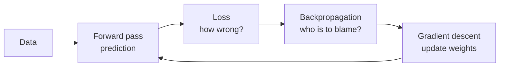
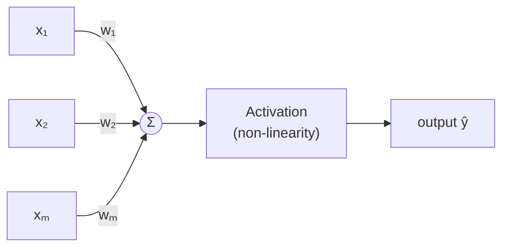
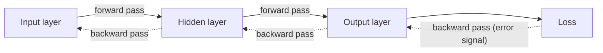
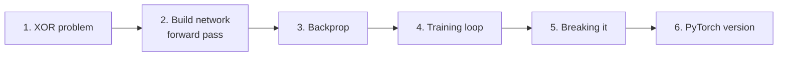
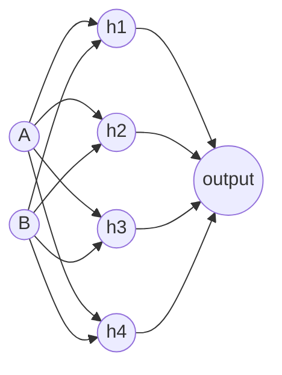

# 📘 Class 02 — Neural Networks from Scratch

> **Bootcamp:** 100xBootcamp by Harkirat Singh  
> **Week 2 — AI and ML** | **Date:** 24/01/2026  
> **Theme:** How Machines Actually Learn  
> **Class material:** Slides (*Neural Networks from Scratch*) + Google Colab notebook (`class2.ipynb`)  
> **Next class:** Transformers & Attention

---

## 1. Class Overview

In Class 01 we saw *that* machines learn from examples instead of rules. This class opens the box and shows **how** the learning actually happens.

We start with the simplest prediction problem (house size → price), build up the **neuron**, see why **activation functions** are essential, and then learn the four ideas that make training work: **loss function**, **backpropagation**, **gradient descent** and **learning rate**. In the Colab notebook we build a small neural network from scratch with NumPy, train it on the **XOR problem**, break it on purpose, and finally redo it in PyTorch.



## 2. Learning Objectives

After studying these notes you should be able to:

- Explain what a **neuron** computes: `output = activation(Σ wᵢxᵢ + b)`.
- Explain why stacking linear layers **collapses** and why **activation functions** fix it.
- Name and compare **Sigmoid, Tanh, ReLU, GELU/Swish**.
- Calculate **Mean Squared Error** for a prediction.
- Explain **backpropagation** and **gradient descent** with the blindfolded-hiker analogy.
- Explain what the **learning rate** does and what goes wrong if it is too high or too low.
- Describe the 4-step **training loop** and read the NumPy and PyTorch code for it.
- Explain why a single neuron **cannot solve XOR** but a network with a hidden layer can.

## 3. Topics Covered

1. Recap: from rules to patterns
2. The simplest prediction problem (house price)
3. Machine learning in one sentence (guess → measure → adjust → repeat)
4. The neuron: a tiny decision maker
5. Anatomy of a neuron (weights, bias, activation)
6. Why we need activation functions (the linearity problem)
7. The activation function menu
8. The loss function (MSE)
9. Backpropagation: assigning blame
10. Learning rate
11. Gradient descent: finding the valley
12. The training loop: putting it all together
13. Scaling to the moon (XOR network vs GPT-4)
14. **Colab notebook:** XOR problem, network from scratch, backprop, training, breaking it, PyTorch version

---

## 4. Detailed Class Notes

### 4.1 From Rules to Patterns: A Quick Recap

| Traditional Programming | Machine Learning |
|---|---|
| **Rules don't scale:** humans cannot write rules for every possible scenario in complex tasks. | **Pattern discovery:** finding consistent mathematical relationships within large datasets. |
| **Rigid logic:** systems fail when they meet data that doesn't fit the predefined rules. | **The goal (of this class):** understand the fundamental mechanics of how this discovery happens. |

### 4.2 The Simplest Prediction Problem

| Size (sq ft) | Price |
|---|---|
| 1,000 | $200,000 |
| 1,500 | $300,000 |
| 2,000 | $400,000 |
| 2,500 | **?** |

> **The challenge:** How do we teach a machine to find the mathematical relationship (e.g., **$200 per sq ft**) automatically?

A human spots the pattern immediately: price = 200 × size. The machine must *discover* this on its own, from the examples only.

> 💡 **Additional Explanation — a single neuron learns this pattern**  
> The slide leaves the `?` unanswered. Using the pattern, 2,500 sq ft → **$500,000**. Here is a one-neuron "machine" that finds the rule itself. (We use units of 1,000 sq ft and $100,000 to keep the numbers small and training stable.)

```python
# size in 1000 sq ft, price in $100,000
size  = [1.0, 1.5, 2.0]
price = [2.0, 3.0, 4.0]

w, b = 0.0, 0.0      # start with a guess
lr = 0.1             # learning rate

for epoch in range(2000):
    for x, target in zip(size, price):
        error = (w * x + b) - target     # how wrong is the guess?
        w -= lr * error * x              # adjust weight slightly
        b -= lr * error                  # adjust bias slightly

print(round(w, 3), round(b, 3))          # learned rule
print("Price for 2500 sq ft:", round(w * 2.5 + b, 3))
```

**Output:**
```
2.0 0.0
Price for 2500 sq ft: 5.0
```

*Explanation:* `w = 2.0` means "$200,000 per 1,000 sq ft" = **$200/sq ft**, exactly the rule from the slide. `b = 0` means no fixed base price. The machine found it by repeating guess → error → adjust.

### 4.3 Machine Learning in One Sentence

> **Training is a simple, iterative loop of guessing and correcting.**

| Step | Name | Meaning |
|---|---|---|
| 01 | **Start with a guess** | Initialize with random values. |
| 02 | **Measure error** | How far is the guess from the truth? |
| 03 | **Adjust** | Modify the guess to be slightly less wrong. |
| 04 | **Repeat** | Do this millions of times until error is minimized. |

The slide's diagram shows the same loop: **forward propagation** (inputs → predictions), compare with **true values** using a **loss function**, get a **loss score**, and an **optimizer** performs a **weight update** through **backward propagation**. This repeats until the loss is minimized.

*(This is the same loop from Class 01: try → feedback → adjust → repeat.)*

### 4.4 The Neuron: A Tiny Decision Maker

> The building block of AI is a **simple mathematical function, not a biological mystery.** It takes numbers in, performs basic arithmetic, and outputs a signal.

| Part | What it is |
|---|---|
| **1. Inputs** | Numerical data points representing features (e.g., house size, pixel intensity). |
| **2. Weights & Summation** | Importance assigned to each input, combined into a single weighted sum. |
| **3. Activation** | A non-linear function that decides whether the signal should "fire" or be suppressed. |



### 4.5 Anatomy of a Neuron

$$\text{output} = \text{activation}\left(\sum_i w_i x_i + b\right)$$

| Symbol | Name | Role |
|---|---|---|
| $x_i$ | Inputs | The features |
| $w_i$ | **Weights** | Determine the strength and importance of each input signal |
| $b$ | **Bias** | An offset that allows the neuron to shift its decision boundary |
| $\sum$ | Summation | Adds up all weighted inputs |
| activation | **Activation function** | A non-linear function that decides if the signal should "fire" |

**Numerical example:** inputs $x = [2, 3]$, weights $w = [0.5, -1]$, bias $b = 1$:

$z = (0.5)(2) + (-1)(3) + 1 = 1 - 3 + 1 = -1$. With sigmoid: $\sigma(-1) \approx 0.27$.

```python
import numpy as np

def sigmoid(z):
    return 1 / (1 + np.exp(-z))

x = np.array([2, 3])
w = np.array([0.5, -1])
b = 1

z = np.dot(w, x) + b     # weighted sum + bias
output = sigmoid(z)      # activation
print(z, round(output, 2))
```

**Output:**
```
-1.0 0.27
```

*Explanation:* `np.dot(w, x)` computes $\sum w_i x_i$. Then we add the bias and pass the result through sigmoid.

### 4.6 Why We Need Activation Functions

#### The linearity problem

$$
\begin{aligned}
\text{Layer 1: } & y = W_1 x + b_1 \\
\text{Layer 2: } & z = W_2 y + b_2 \\
\text{Combined: } & z = W_2(W_1 x + b_1) + b_2 = (W_2 W_1)x + (W_2 b_1 + b_2)
\end{aligned}
$$

This simplifies to $z = W'x + b'$ where $W' = W_2W_1$ and $b' = W_2b_1 + b_2$.

> **Mathematical collapse:** Stacking linear layers just results in another linear function. **100 layers are equivalent to just one.**

#### The non-linear solution

| Idea | Meaning |
|---|---|
| **Breaking linearity** | Activation functions add "bends" to the math, preventing layers from collapsing into each other. |
| **Enabling depth** | The "secret sauce" that allows deep networks to learn complex, multi-layered representations. |
| **Universal approximation** | Non-linearity allows networks to model any continuous function, no matter how complex. |

> 💡 **Additional Explanation — see the collapse in code**

```python
import numpy as np
rng = np.random.default_rng(0)

W1, b1 = rng.normal(size=(3, 4)), rng.normal(size=4)
W2, b2 = rng.normal(size=(4, 2)), rng.normal(size=2)
x = rng.normal(size=3)

two_layers = (x @ W1 + b1) @ W2 + b2             # two linear layers
one_layer  = x @ (W1 @ W2) + (b1 @ W2 + b2)      # ONE equivalent layer
print("Two linear layers == one layer:", np.allclose(two_layers, one_layer))

relu = lambda v: np.maximum(0, v)
with_relu = relu(x @ W1 + b1) @ W2 + b2          # ReLU in between
print("With ReLU == one layer:", np.allclose(with_relu, one_layer))
```

**Output:**
```
Two linear layers == one layer: True
With ReLU == one layer: False
```

*Explanation:* Two linear layers can be merged into one (`W1 @ W2`). Once a ReLU sits between them, no single linear layer can reproduce the result, so depth now adds real power.

> ⚠️ **Clarification (universal approximation)**  
> The slide's statement is preserved. The precise version is: a network with a non-linear activation and **enough neurons** can approximate any continuous function to any accuracy (on a bounded input range). It says such a network *exists*, not that training will always *find* it.

### 4.7 The Activation Function Menu

| Function | Formula / range | Notes from class |
|---|---|---|
| **Sigmoid** | $\sigma(x)=\frac{1}{1+e^{-x}}$, range (0, 1) | Classic S-curve. Historically the default, ideal for **probability outputs**. |
| **Tanh** | range (−1, 1) | **Zero-centered.** Often provides **faster convergence** than sigmoid. |
| **ReLU** | $\max(0, x)$ | **The breakthrough.** Simple, efficient, and enabled deep networks. |
| **Modern variants (GELU & Swish)** | smooth versions of ReLU | Used in state-of-the-art LLMs. |

```python
import numpy as np
z = np.array([-2, 0, 2])
print("sigmoid:", (1 / (1 + np.exp(-z))).round(3))
print("tanh   :", np.tanh(z).round(3))
print("relu   :", np.maximum(0, z))
```

**Output:**
```
sigmoid: [0.119 0.5   0.881]
tanh   : [-0.964  0.    0.964]
relu   : [0 0 2]
```

### 4.8 The Loss Function

> **Loss = a single number measuring how wrong we are.**  
> Lower loss = better predictions. **Training goal = minimize loss.**

**Mean Squared Error (MSE):**

$$L = \frac{1}{n}\sum_{i=1}^{n}(\text{prediction}_i - \text{target}_i)^2$$

- Squares make all errors positive.
- Big errors are penalized more than small errors.
- Good for **regression** tasks.

**Example from class:**

| Predicted | Actual | Error | Squared |
|---|---|---|---|
| $350,000 | $400,000 | $50,000 | **2,500,000,000** |

```python
import numpy as np
pred   = np.array([350_000])
actual = np.array([400_000])
print(np.mean((pred - actual) ** 2))
```

**Output:**
```
2500000000.0
```

*Explanation:* With one example, MSE is just the squared error. With many examples, we average the squared errors.

### 4.9 Backpropagation: Assigning Blame

**The chain of responsibility**

- **The question:** *"The prediction was wrong. Which specific weights are responsible for this error?"*
- **The flow:** Error signals travel **backward** from the output layer through the hidden layers to the input.
- **Adjustment:** Each weight is adjusted **proportionally to its contribution** to the final mistake.



> 📌 **Extra Context**  
> Mathematically, backpropagation uses the **chain rule** from calculus to compute $\frac{\partial L}{\partial w}$ for every weight: *"if I nudge this weight a tiny bit, how much does the loss change?"* That number is the weight's share of the "blame". The slide's diagram labels this as $\frac{\partial Loss}{\partial w}$.

### 4.10 Learning Rate

The learning rate slide uses the **blindfolded-on-a-hilly-landscape** analogy:

- Your goal is to reach the lowest valley.
- **The landscape:** the "**Loss Surface**" represents all possible errors the model can make.

The slide's diagram compares three cases:

| Learning rate | What happens |
|---|---|
| **Too low** | A small learning rate requires many updates before reaching the minimum point. |
| **Just right** | The optimal learning rate swiftly reaches the minimum point. |
| **Too high** | Too large a learning rate causes drastic updates which lead to **divergent behaviour**. |

> 💡 **Additional Explanation — all three cases on $f(w) = w^2$**  
> The minimum of $f(w)=w^2$ is at $w=0$. The gradient is $2w$. We start at $w=5$ and take 10 steps.

```python
def descend(lr, steps=10):
    w = 5.0
    for _ in range(steps):
        w = w - lr * 2 * w       # w = w - learning_rate * gradient
    return w

for lr in (0.001, 0.4, 1.1):
    print(f"lr={lr:<6} -> w after 10 steps = {descend(lr):.6f}")
```

**Output:**
```
lr=0.001  -> w after 10 steps = 4.900895
lr=0.4    -> w after 10 steps = 0.000001
lr=1.1    -> w after 10 steps = 30.958682
```

*Explanation:* `lr=0.001` barely moves (too low). `lr=0.4` almost reaches 0 (good). `lr=1.1` overshoots the valley each time and ends *farther* than it started (diverges).

### 4.11 Gradient Descent: Finding the Valley

| The analogy | The strategy |
|---|---|
| Imagine you are **blindfolded on a hilly landscape**. Your goal is to reach the lowest valley. | **Step downhill:** feel the slope and take a step in the direction that reduces the loss. |
| **The landscape:** the Loss Surface. | **Iterative progress:** repeat, step after step, until you reach the bottom. |
| **The gradient:** the slope under your feet. It tells you which direction is "down" for the loss. | **The goal:** reach the **global minimum**, the point where the model's error is as low as possible. |

**The update rule:**

$$w_{\text{new}} = w_{\text{old}} - \eta \cdot \frac{\partial L}{\partial w}$$

- $\eta$ (eta) = **learning rate** (step size)
- $\frac{\partial L}{\partial w}$ = **gradient** (slope of the loss with respect to the weight)
- The **minus** sign: the gradient points uphill, so we go the opposite way.

> ⚠️ **Clarification (global minimum)**  
> The slide's goal is preserved: find the lowest point of the loss. In real deep networks the surface has many valleys and flat spots, and gradient descent is **not guaranteed** to find the single global minimum. In practice it finds a *good enough* low point. You will see this in the notebook: the same network can get stuck depending on the random starting weights (section 4.17).

### 4.12 The Training Loop: Putting It All Together

| Step | Name | What happens |
|---|---|---|
| 01 | **Forward pass** | Data flows through the network to generate a prediction. |
| 02 | **Calculate loss** | Measure the error between the prediction and the ground truth. |
| 03 | **Backpropagate** | Trace the error backward to assign "blame" to each weight. |
| 04 | **Update weights** | Adjust weights using gradient descent to minimize future error. |

*Note:* the picture on this slide shows common activation functions (linear, sigmoid, tanh) and their derivatives. It does not illustrate the loop itself, but it connects to it: **gradients depend on the derivative of the activation**. Sigmoid's derivative is at most 0.25, which matters in section 4.15.

### 4.13 Scaling to the Moon

| Network | Parameters |
|---|---|
| **XOR network** | ~20 parameters |
| **GPT-4** | ~1 trillion |

The **same four steps** (forward pass, loss calculation, backpropagation, weight updates) run for both. Only the size changes.

> ⚠️ **Clarification**  
> The notebook's XOR network has exactly **17** parameters (see 4.16), which matches the slide's "~20". The GPT-4 figure is **not officially published** by OpenAI; "~1 trillion" is an unconfirmed estimate, so treat it as a rough order of magnitude.

---

### 4.14 Colab Notebook: Overview (`class2.ipynb`)

The notebook goal: *"understand exactly what happens when someone says 'the model is training.' No magic, no hand-waving."* It builds a network with **NumPy only**, trains it on a problem a **single neuron cannot solve**, and then shows PyTorch automating the same steps.



### 4.15 Notebook Part 1 — The XOR Problem

**XOR (exclusive or):** if the inputs are **different** → output 1; if they are the **same** → output 0.

| Input A | Input B | Output |
|---|---|---|
| 0 | 0 | 0 |
| 0 | 1 | 1 |
| 1 | 0 | 1 |
| 1 | 1 | 0 |

**Why it matters (from the notebook):** a single-layer perceptron (one neuron) **cannot learn XOR**. Plot the four points on a graph: the two "1" points and the two "0" points sit on opposite diagonals, so **no single straight line can separate them**. A network with at least **one hidden layer** can learn it, because hidden layers create **non-linear boundaries**.

```python
import numpy as np
X = np.array([[0, 0], [0, 1], [1, 0], [1, 1]])   # inputs
y = np.array([[0], [1], [1], [0]])               # targets (XOR)
```

> ⚠️ **Clarification (history)**  
> The notebook says this limitation (Minsky and Papert, 1969) "caused the first AI Winter". Their result is widely cited as one factor in the decline of neural-network research, alongside the broken promises and funding cuts you saw in Class 01. Treat it as *a* cause, not the only one.

### 4.16 Notebook Part 2 — Building the Network (Forward Pass)

**Architecture:**



- **Input layer:** 2 neurons (A and B)
- **Hidden layer:** 4 neurons, sigmoid activation
- **Output layer:** 1 neuron, sigmoid activation (gives a 0–1 value)

**Why sigmoid here?** The output is naturally between 0 and 1 (matches the targets), the math is clean, and it's historically important. *In practice you would use ReLU for hidden layers*, but sigmoid makes it easier to see what's happening.

**Parameters (weights and biases):**

| Part | Shape | Count |
|---|---|---|
| Input→Hidden weights | 2 × 4 | 8 |
| Hidden biases | 1 × 4 | 4 |
| Hidden→Output weights | 4 × 1 | 4 |
| Output bias | 1 × 1 | 1 |
| **Total** | | **17** |

```python
INPUT_SIZE, HIDDEN_SIZE, OUTPUT_SIZE = 2, 4, 1

# small random weights, zero biases
weights_input_hidden  = np.random.randn(INPUT_SIZE, HIDDEN_SIZE) * 0.5
bias_hidden           = np.zeros((1, HIDDEN_SIZE))
weights_hidden_output = np.random.randn(HIDDEN_SIZE, OUTPUT_SIZE) * 0.5
bias_output           = np.zeros((1, OUTPUT_SIZE))
```

*Explanation:* `randn` gives random numbers around 0, `* 0.5` keeps them small, and biases start at 0. This is "step 01: start with a guess".

**Sigmoid and its derivative** (the derivative is needed for backprop):

```python
def sigmoid(x):
    return 1 / (1 + np.exp(-x))

def sigmoid_derivative(x):
    s = sigmoid(x)
    return s * (1 - s)          # σ'(x) = σ(x)(1 − σ(x))
```

**The vanishing gradient hint:** the maximum of sigmoid's derivative is only **0.25**. The notebook shows that multiplying 0.25 over 10 layers gives $0.25^{10} \approx 9.5\times10^{-7}$, so gradients shrink to almost nothing in deep sigmoid networks. This is the **vanishing gradient problem**, one reason ReLU became the breakthrough in 4.7.

**Forward pass:**

$$z_h = XW_1 + b_1,\quad a_h = \sigma(z_h),\quad z_o = a_hW_2 + b_2,\quad \hat{y} = \sigma(z_o)$$

```python
def forward(X):
    z_hidden = np.dot(X, weights_input_hidden) + bias_hidden       # linear combination
    a_hidden = sigmoid(z_hidden)                                   # activation
    z_output = np.dot(a_hidden, weights_hidden_output) + bias_output
    a_output = sigmoid(z_output)
    return z_hidden, a_hidden, z_output, a_output   # keep all, backprop needs them
```

*Explanation:* it returns the intermediate values as well as the prediction because backpropagation reuses them.

**Untrained result (from the saved notebook output; random weights):**

| Input | Prediction | Target |
|---|---|---|
| [0 0] | 0.4467 | 0 |
| [0 1] | 0.4303 | 1 |
| [1 0] | 0.4270 | 1 |
| [1 1] | 0.4126 | 0 |

All predictions sit near 0.5 (pure guessing). **Initial loss (MSE) = 0.2557.**

```python
def compute_loss(y_true, y_pred):
    return np.mean((y_true - y_pred) ** 2)     # MSE
```

### 4.17 Notebook Part 3 — Backpropagation in Code

The notebook walks the "chain of blame" in five steps: (1) error at the output, (2) how much each output weight contributed, (3) send error back to the hidden layer, (4) how much each hidden weight contributed, (5) adjust all weights proportionally.

```python
def backward(X, y, z_hidden, a_hidden, z_output, a_output, learning_rate):
    global weights_input_hidden, bias_hidden, weights_hidden_output, bias_output
    m = X.shape[0]                                   # number of examples

    # ---- OUTPUT LAYER ----
    output_error = a_output - y                      # prediction - target
    output_delta = output_error * sigmoid_derivative(z_output)
    grad_weights_hidden_output = np.dot(a_hidden.T, output_delta) / m
    grad_bias_output = np.mean(output_delta, axis=0, keepdims=True)

    # ---- HIDDEN LAYER ----
    hidden_error = np.dot(output_delta, weights_hidden_output.T)   # blame flows back
    hidden_delta = hidden_error * sigmoid_derivative(z_hidden)
    grad_weights_input_hidden = np.dot(X.T, hidden_delta) / m
    grad_bias_hidden = np.mean(hidden_delta, axis=0, keepdims=True)

    # ---- UPDATE (go opposite to the gradient: downhill) ----
    weights_hidden_output -= learning_rate * grad_weights_hidden_output
    bias_output           -= learning_rate * grad_bias_output
    weights_input_hidden  -= learning_rate * grad_weights_input_hidden
    bias_hidden           -= learning_rate * grad_bias_hidden
```

| Variable | Meaning |
|---|---|
| `output_error` | How far the prediction is from the target |
| `output_delta` | Error × sigmoid slope = gradient of the loss w.r.t. `z_output` |
| `hidden_error` | The output delta sent **backward** through the output weights |
| `hidden_delta` | Hidden error × sigmoid slope |
| `grad_*` | Gradient for each weight and bias (the "blame") |
| `learning_rate * grad` | The small step taken downhill |

> ⚠️ **Clarification**  
> The textbook gradient of MSE has a factor of 2 and a `1/n` term; the notebook drops the 2 (it gets absorbed into the learning rate). This does not change the idea, only the effective step size.

### 4.18 Notebook Part 4 — The Training Loop

```python
np.random.seed(42)            # same starting weights every run
# ... (re-initialise the four weight/bias arrays) ...
learning_rate = 2.0           # how big each step is
iterations = 10000            # how many loops
loss_history = []

for i in range(iterations):
    z_h, a_h, z_o, predictions = forward(X)          # 1. forward pass
    loss = compute_loss(y, predictions)              # 2. loss
    loss_history.append(loss)
    backward(X, y, z_h, a_h, z_o, predictions, learning_rate)   # 3 & 4. backprop + update
```

**Result after 10,000 iterations (clean run, seed 42):**

| Input | Target | Prediction | Rounded |
|---|---|---|---|
| [0 0] | 0 | ≈ 0.019 | 0 ✅ |
| [0 1] | 1 | ≈ 0.985 | 1 ✅ |
| [1 0] | 1 | ≈ 0.984 | 1 ✅ |
| [1 1] | 0 | ≈ 0.015 | 0 ✅ |

Loss went from **≈ 0.2557** (random guessing) to **≈ 0.00027** (learning). The network learned XOR from random weights.

> ⚠️ **Clarification (the numbers in the saved notebook)**  
> The saved Colab output shows "Iteration 0 | Loss: 0.000265" and slightly different predictions (0.0124, 0.9898…). That happens when the training cell is run again **without** re-running the reset cell: training simply *continues* from the already-trained weights. A clean run from the reset cell starts at ≈ 0.2557 as shown above. Always re-run the reset cell before retraining.

### 4.19 Notebook Part 5 — Breaking It (Experiments)

*"Understanding what breaks a network teaches you more than seeing it work."*

| Experiment | Setting | What the notebook shows |
|---|---|---|
| **1. Learning rate too high** | lr = 100 | Loss does not settle. It jumps around instead of decreasing smoothly. |
| **2. Learning rate too low** | lr = 0.001, 10,000 iterations | Barely moves. Predictions stay ≈ 0.47–0.50 for all four inputs. |
| **3. Not enough hidden neurons** | 2 hidden neurons instead of 4 | In the saved run, two of the four predictions stay stuck near 0.5. |

I re-ran these from a clean start to check them:

- **lr = 100:** the loss stayed around 0.25–0.5 and never converged; the predictions saturated near 0 or 1 and were wrong for some inputs.
- **lr = 0.001:** loss only went from 0.2557 to ≈ 0.2507 after 10,000 iterations (predictions ≈ 0.50, 0.49, 0.48, 0.47, which matches the notebook).
- **2 hidden neurons, seed 42:** stuck (predictions ≈ 0.02, 0.50, 0.98, 0.50).

> ⚠️ **Clarification (Experiment 3 — "not enough capacity")**  
> The notebook's conclusion ("not enough hidden neurons, so the network may not have enough capacity") is kept as the class teaching point, with one important correction. In theory **2 hidden neurons are enough for XOR**. When I tried other random seeds (0, 1, 2), the same 2-neuron network **learned XOR successfully** (loss ≈ 0.0003). So seed 42 got stuck in a bad spot of the loss surface, which is the "not guaranteed to reach the global minimum" point from 4.11. Smaller networks are *more likely* to get stuck, but "too few neurons" is not the whole story.  
> Also, in `backward_small` the output weights are updated **before** the hidden error is computed, so it uses slightly newer weights than the textbook algorithm. In my tests this did not change the results, but it is a small difference from the main `backward` function.

### 4.20 Notebook Part 6 — The PyTorch Version

> **The concepts are identical. The code is cleaner.** `loss.backward()` does all the backprop math automatically; `optimizer.step()` updates the weights automatically.

```python
import torch
import torch.nn as nn
import torch.optim as optim

X_tensor = torch.FloatTensor(X)
y_tensor = torch.FloatTensor(y)

class XORNet(nn.Module):
    def __init__(self):
        super(XORNet, self).__init__()
        self.hidden  = nn.Linear(2, 4)    # 2 inputs → 4 hidden
        self.output  = nn.Linear(4, 1)    # 4 hidden → 1 output
        self.sigmoid = nn.Sigmoid()

    def forward(self, x):
        x = self.sigmoid(self.hidden(x))
        x = self.sigmoid(self.output(x))
        return x

torch.manual_seed(42)
model = XORNet()
criterion = nn.MSELoss()                              # loss function
optimizer = optim.SGD(model.parameters(), lr=2.0)     # gradient descent

for i in range(10000):
    predictions = model(X_tensor)                     # forward pass
    loss = criterion(predictions, y_tensor)           # loss
    optimizer.zero_grad()                             # clear old gradients
    loss.backward()                                   # BACKPROP (automatic)
    optimizer.step()                                  # update weights
```

| Our NumPy code | PyTorch equivalent |
|---|---|
| `forward(X)` | `model(X_tensor)` |
| `compute_loss` | `nn.MSELoss()` |
| `backward(...)` (gradients by hand) | `loss.backward()` |
| `weights -= lr * grad` | `optimizer.step()` |
| Weight arrays | `nn.Linear` layers |

**Saved PyTorch output:** loss went from 0.2866 (iteration 0) to 0.000098 (iteration 10,000), with predictions ≈ 0.009, 0.989, 0.991, 0.011 for the four XOR inputs. Both implementations reach the same result.

> 📌 **Extra Context**  
> `optimizer.zero_grad()` is needed because PyTorch **adds up** gradients between calls by default; without clearing them, each step would use stale gradients. I could not run the PyTorch cells myself (PyTorch isn't installed in my environment), so the PyTorch numbers above are taken from the saved notebook output.

---

## 5. Additional Explanations

> 💡 **Additional Explanation — how the slide ideas map to the notebook**

| Slide concept | Where it appears in the notebook |
|---|---|
| Neuron: `activation(Σwx + b)` | `np.dot(X, W) + b` then `sigmoid(...)` in `forward` |
| Activation function | `sigmoid`, `sigmoid_derivative` |
| Loss (MSE) | `compute_loss` |
| Backpropagation | `backward` (`output_delta`, `hidden_delta`) |
| Gradient descent | `weights -= learning_rate * grad` |
| Learning rate | `learning_rate = 2.0`, and Experiments 1 and 2 |
| Training loop | the `for i in range(iterations)` cell |
| Scaling | 17 parameters here vs billions in LLMs |

> 💡 **Additional Explanation — terms you will keep meeting**

| Term | Simple meaning |
|---|---|
| **Parameters** | All the weights and biases the model can adjust |
| **Hyperparameters** | Settings *you* choose before training (learning rate, hidden size, iterations) |
| **Epoch / iteration** | One pass of the training loop (here every iteration uses all 4 examples) |
| **Gradient** | Slope of the loss with respect to a weight |
| **Regression** | Predicting a number (house price) |
| **Hidden layer** | A layer between input and output |

**Common mistakes / misconceptions**

- ❌ "A neuron is a tiny brain." → It is just `activation(Σwx + b)`.
- ❌ "More layers always means more power." → Not without activation functions (100 linear layers = 1).
- ❌ "Higher learning rate = faster learning." → Too high makes the loss bounce around or blow up.
- ❌ "Training always finds the best solution." → The same network can succeed or get stuck depending on the random start.
- ❌ "Backpropagation is the learning." → Backprop only *computes* the blame; **gradient descent** uses it to *update* the weights.

---

## 6. Key Takeaways

1. **Neural networks are layers of simple neurons doing weighted sums** (plus bias and activation).
2. **Training is the iterative process of adjusting weights to minimize loss.**
3. **Backpropagation traces error backward to assign "blame" to weights.**
4. **Gradient descent is the strategy for stepping toward lower loss.**
5. Without **non-linear activation functions**, stacked layers collapse into a single linear function.
6. The **learning rate** must be balanced: too low is painfully slow, too high diverges.
7. The training loop is always: **forward pass → loss → backprop → update weights**.
8. A single neuron cannot solve **XOR**; a hidden layer can.
9. PyTorch automates the gradient calculation (`loss.backward()`, `optimizer.step()`), but the concepts are the same as the from-scratch version.

## 7. Quick Revision (≈ 5 minutes)

**Important definitions**

- **Neuron:** a function that takes numbers in, computes a weighted sum plus bias, and applies an activation.
- **Weights:** importance of each input. **Bias:** offset that shifts the decision boundary.
- **Activation function:** non-linear function that decides if the signal "fires".
- **Loss:** one number measuring how wrong the model is. **Training = minimize loss.**
- **Backpropagation:** sends the error backward to find each weight's share of the blame.
- **Gradient descent:** repeatedly step in the direction that reduces the loss.
- **Learning rate:** the size of each step.

**Important formulas**

- Neuron: $\text{output} = f\left(\sum_i w_i x_i + b\right)$
- MSE: $L = \frac{1}{n}\sum(\text{prediction}-\text{target})^2$
- Update rule: $w \leftarrow w - \eta\,\frac{\partial L}{\partial w}$
- Sigmoid: $\sigma(x)=\frac{1}{1+e^{-x}}$, $\sigma'(x)=\sigma(x)(1-\sigma(x))$ (max 0.25)
- ReLU: $\max(0, x)$
- Linear collapse: $W_2(W_1x+b_1)+b_2 = (W_2W_1)x + (W_2b_1+b_2)$

**Activation cheat-sheet**

| Function | Range | Remember |
|---|---|---|
| Sigmoid | (0, 1) | Probabilities; vanishing gradients |
| Tanh | (−1, 1) | Zero-centered |
| ReLU | [0, ∞) | Simple, fast, enabled deep nets |
| GELU / Swish | smooth ReLU-like | Used in modern LLMs |

**Learning rate cheat-sheet:** too low → very slow; just right → smooth descent; too high → overshoot / diverge.

**Training loop:** Forward pass → Calculate loss → Backpropagate → Update weights → repeat.

**Notebook facts:** XOR net = 2 → 4 → 1, sigmoid everywhere, 17 parameters, lr = 2.0, 10,000 iterations, MSE loss; initial loss ≈ 0.2557.

---

## 8. Self-Assessment Questions

1. **(Conceptual)** Write the formula for a neuron's output and explain the role of weights, bias and activation.
2. **(Conceptual)** Why do 100 stacked linear layers behave like a single layer? What fixes this?
3. **(Short answer)** Compare Sigmoid, Tanh and ReLU in one line each.
4. **(Technical)** A model predicts $350,000 for a house that actually sold for $400,000. Compute the squared error. Why do we square it?
5. **(Technical)** Explain the difference between **backpropagation** and **gradient descent**.
6. **(Conceptual)** Using the blindfolded-hiker analogy, explain the loss surface, gradient and learning rate.
7. **(Application)** What happens to training if the learning rate is (a) too low, (b) too high? How did the notebook show this?
8. **(Technical)** List the four steps of the training loop and the PyTorch line that performs each of the last two.
9. **(Application)** Why can't a single neuron solve XOR? What does a hidden layer add?
10. **(Technical)** How many parameters does the notebook's 2→4→1 network have? Show the calculation.

<details>
<summary><b>Click to reveal answers</b></summary>

1. $\text{output} = \text{activation}(\sum w_ix_i + b)$. **Weights** set how important each input is, **bias** shifts the decision boundary, and the **activation** is a non-linear function that decides whether the signal "fires".

2. Because combining two linear layers gives $W_2(W_1x+b_1)+b_2 = (W_2W_1)x + (W_2b_1+b_2)$, which is just another linear function. **Non-linear activation functions** between the layers add "bends" so layers can't be merged, which allows depth to learn complex representations.

3. **Sigmoid:** S-curve between 0 and 1, good for probabilities. **Tanh:** zero-centered between −1 and 1, often converges faster than sigmoid. **ReLU:** `max(0, x)`, simple and efficient, the breakthrough that enabled deep networks.

4. Error = 400,000 − 350,000 = 50,000; squared = **2,500,000,000**. We square so all errors are positive and big errors are penalized more than small ones.

5. **Backpropagation** *computes* the gradients, i.e. how much each weight contributed to the error (error flows backward). **Gradient descent** *uses* those gradients to *update* the weights by stepping downhill: $w \leftarrow w - \eta\,\partial L/\partial w$.

6. The **loss surface** is the landscape of all possible errors; the hiker wants the lowest valley. The **gradient** is the slope under the hiker's feet, showing which direction is downhill. The **learning rate** is the size of each step: too small and you take forever, too large and you overshoot the valley.

7. (a) **Too low:** loss barely decreases; in the notebook (lr = 0.001) predictions after 10,000 iterations were still ≈ 0.5 for every input. (b) **Too high:** steps overshoot so the loss bounces around or diverges; in the notebook (lr = 100) the loss did not settle.

8. 1) **Forward pass** (`model(X)`), 2) **Calculate loss** (`criterion(...)`), 3) **Backpropagate** (`loss.backward()`), 4) **Update weights** (`optimizer.step()`).

9. XOR's classes are on opposite diagonals so no single straight line separates them, and one neuron can only draw a straight (linear) boundary. A **hidden layer with non-linear activations** lets the network combine several boundaries into a **non-linear** one.

10. Input→hidden weights 2×4 = 8, hidden biases 4, hidden→output weights 4×1 = 4, output bias 1. Total = 8 + 4 + 4 + 1 = **17**.

</details>

---

*Notes prepared from the class slides "Neural Networks from Scratch" (Week 2 — AI and ML, 24/01/2026) and the shared Colab notebook `class2.ipynb`. Items marked 💡 / 📌 / ⚠️ are additional context or clarifications and were **not** necessarily taught in class.*